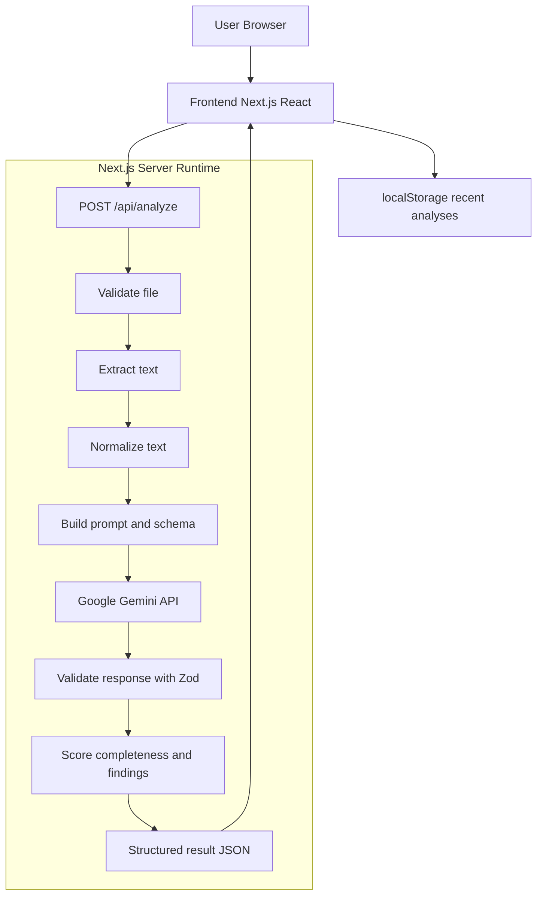

# AI-Powered Document Intelligence Platform

An AI-driven platform for uploading and analyzing documents (PDF/TXT) with structured insights, extraction quality checks, and an interactive results dashboard.

## 🌐 Live Demo

- **Production URL:** https://resumelens-development-h6a7y8pss-kvishalini2-5224s-projects.vercel.app/

## 🚀 Overview

This project provides an end-to-end document intelligence workflow:
- Upload document files
- Extract and normalize text
- Analyze with Google Gemini
- Validate and score extracted insights
- View results in structured tabs
- Save recent analyses in browser history

## 🧭 Architecture at a Glance

| Layer | What it uses | Purpose |
|---|---|---|
| Frontend | Next.js App Router, React, TypeScript, Tailwind CSS | Upload files, configure analysis, visualize structured results |
| Backend | Next.js API Route (`app/api/analyze/route.ts`) | Validate input, parse/extract text, orchestrate AI pipeline |
| AI/ML | Google Gemini (`gemini-3.8-flash`) via `@google/genai` | Generate grounded summaries, fields, and insights |
| Validation | Zod | Enforce schema-safe AI response structure |
| Parsing | `unpdf`, browser `File.text()` | Extract text from PDF/TXT documents |
| Storage | Browser `localStorage` | Save recent analyses locally on device |
| Deployment | Vercel | Host and serve the app |

## ⚡ One-Click Local Run

```bash
pnpm install && pnpm dev
```

Open your browser at `http://localhost:3000`.

## ✨ Key Features

- PDF and `.txt` document upload
- Validation for file type, size, and content quality
- Multiple analysis depth modes (basic/standard/detailed)
- Configurable summary style and focus areas
- Structured outputs: summary, extracted fields, insights, completeness score
- Result exploration via Overview, Fields, Insights, and Raw JSON tabs
- Export actions: Copy JSON, Download JSON, Print/PDF
- Local history with search, sorting, compare, and delete

## 🧰 Technologies and Frameworks

- **Frontend:** Next.js (App Router), React, TypeScript
- **Backend:** Next.js API Routes (`app/api/analyze/route.ts`), server-side processing in the Next.js runtime
- **Styling/UI:** Tailwind CSS, component primitives, Framer Motion, Recharts
- **Parsing/Validation:** `unpdf`, Zod
- **Deployment:** Vercel

## 🤖 AI/ML Model, APIs, and Services Used

- **Primary AI/ML model:** `gemini-3.8-flash` (configurable via `GEMINI_MODEL`)
- **AI API provider:** Google Gemini API via `@google/genai`
- **Hosting/Deployment:** Vercel

## 📁 Suggested Project Structure

```text
.
├── app/
│   ├── api/
│   │   └── analyze/
│   │       └── route.ts
│   ├── analyze/
│   └── history/
├── components/
├── lib/
│   ├── parser/
│   ├── validators/
│   └── scoring/
├── public/
├── styles/
├── .env.example
└── README.md
```

## ⚙️ Setup and Execution Instructions

### 1) Install dependencies

```bash
pnpm install
```

### 2) Configure environment

```bash
cp .env.example .env.local
```

Then set required values in `.env.local`.

### 3) Start development server

```bash
pnpm dev
```

Open your browser at `http://localhost:3000`.

### 4) Build and run production mode locally

```bash
pnpm build
pnpm start
```

## 🔐 Required Environment Variables (names only)

| Name | Required | Description |
|---|---|---|
| `GEMINI_API_KEY` | Yes (for live AI analysis) | Server-side key for Gemini API |
| `GEMINI_MODEL` | No | Optional model override |

## 🔌 API Example (`POST /api/analyze`)

### Example Request (multipart/form-data)

```bash
curl -X POST "http://localhost:3000/api/analyze" \
  -H "Accept: application/json" \
  -F "file=@./samples/sample.pdf" \
  -F "analysisDepth=standard" \
  -F "summaryStyle=concise" \
  -F "focusAreas=risks,dates,entities"
```

### Example Success Response

```json
{
  "summary": "Contract reviewed with key risks around termination and payment terms.",
  "extractedFields": {
    "documentType": "Contract",
    "effectiveDate": "2026-09-10",
    "parties": ["Company A", "Company B"]
  },
  "insights": [
    {
      "title": "Termination Clause Risk",
      "severity": "medium",
      "description": "Termination notice period is shorter than standard policy."
    }
  ],
  "completenessScore": 0.87,
  "raw": {
    "model": "gemini-3.8-flash"
  }
}
```

### Example Error Response

```json
{
  "error": "Unsupported file type. Please upload PDF or TXT."
}
```

## 🧪 Instructions for Testing Main Features

### Manual test checklist

1. Upload a valid PDF and run analysis.
2. Upload a valid `.txt` file and run analysis.
3. Try invalid files (unsupported type / oversized / empty content) and verify error messages.
4. Test all analysis depth modes (`basic`, `standard`, `detailed`).
5. Test different summary styles/focus options and compare output.
6. Verify all result tabs render correctly:
   - Overview
   - Fields
   - Insights
   - Raw JSON
7. Verify export actions:
   - Copy JSON
   - Download JSON
   - Print/PDF
8. Verify local history features:
   - Save recent runs
   - Search/sort
   - Compare entries
   - Delete entries

## 🏗️ Architecture Diagram



### Diagram Notes

- Validate file includes type, size, and content checks.
- Extract text uses `unpdf` for PDF and `File.text()` for TXT.
- Normalize step cleans and truncates text before prompting.
- Response is schema-validated using Zod before scoring.

## 📡 Processing Flow

1. User uploads document and selects analysis options.
2. API route validates file constraints.
3. Server extracts and normalizes text.
4. Prompt + schema are sent to Gemini.
5. Response is validated and scored.
6. Structured results are returned to UI and optionally persisted in local browser history.

## ⚠️ Known Limitations / Incomplete Features

- Supports **PDF** and **TXT** only (no DOCX yet)
- File size and text-length limits apply
- Scanned image-only PDFs require OCR (not yet implemented)
- History is browser-local (not synced to cloud/account)
- AI output quality depends on model behavior and input quality
- Automated unit/integration test suite is not yet fully implemented

## 🛣️ Roadmap

- Add DOCX support
- Add OCR pipeline for scanned PDFs
- Introduce authentication and cloud history sync
- Add automated unit/integration tests
- Add confidence scoring per extracted field

## 📄 License

Add your preferred license (for example, MIT) in a `LICENSE` file.
